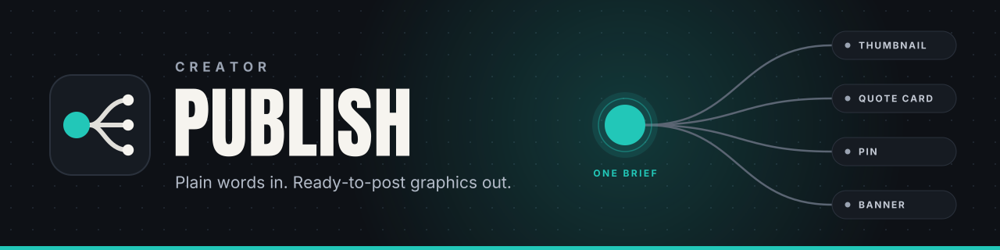
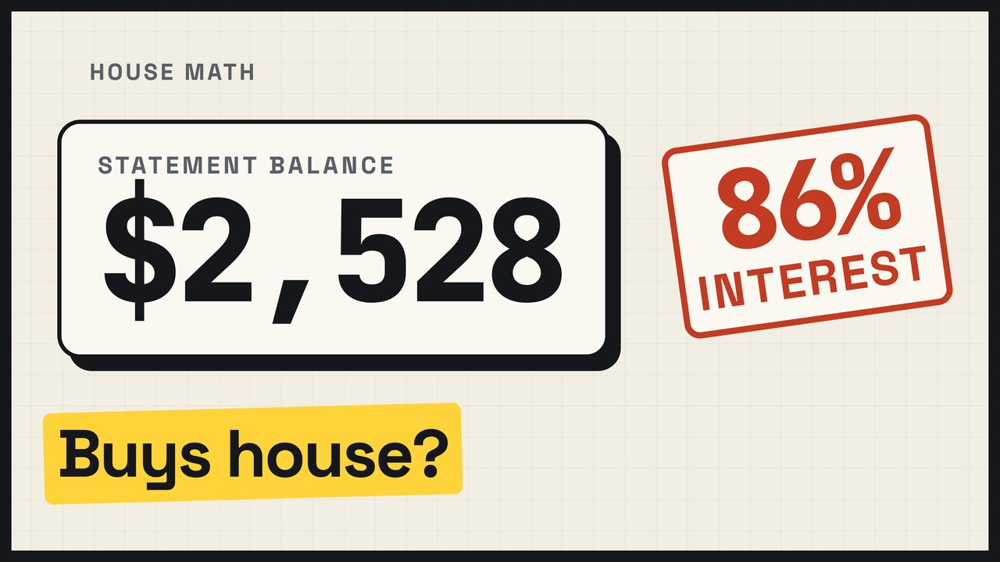
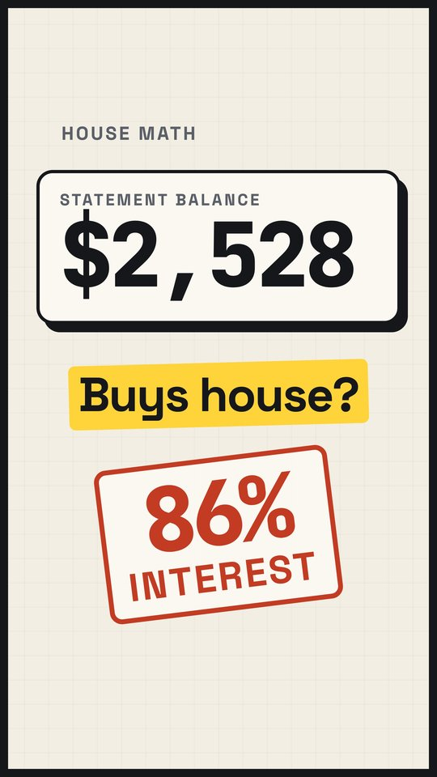
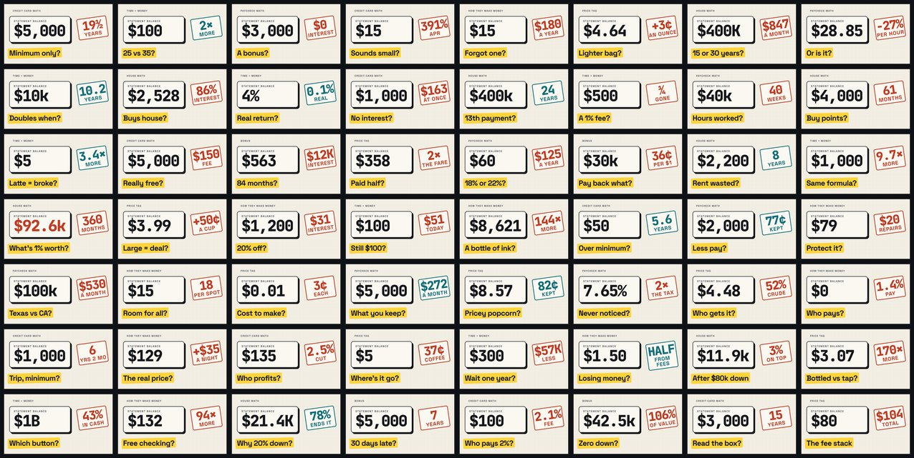
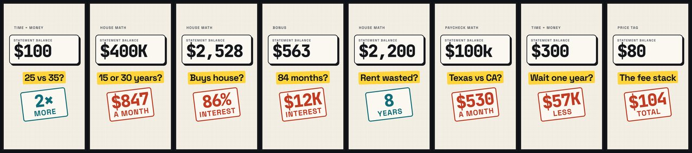
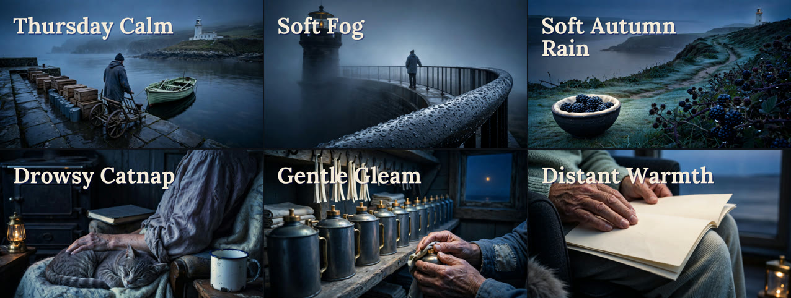
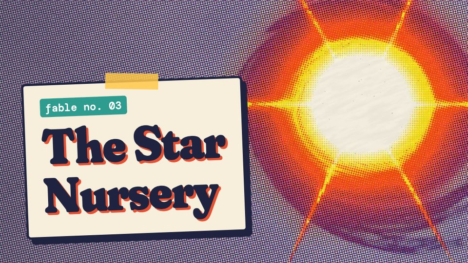
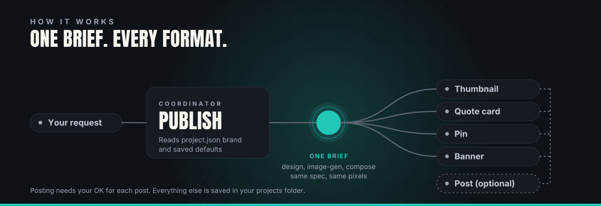

<div align="center">

<h1></h1>

**Ask for a thumbnail, quote card, pin or banner in plain words. Skills design it, render it exactly on your machine, remember your brand and settings per project, and post only when you say so.**

[](https://github.com/sebby26-cyber/creator-publish/actions/workflows/validate.yml)
[](LICENSE)
[](https://docs.claude.com/en/docs/claude-code/plugins)
[](plugins/compose/renderer/package.json)
[](plugins/compose/renderer/src/mcp.js)

</div>

---

## What you can make

| You say | You get |
|---|---|
| "Thumbnail drafts for episode 12 from this video" | Frames grabbed from the video, 3 layouts with your exact title, PNG/JPG/WebP at exact size |
| "Quote cards that say 'Open late.', square" | Typeset cards in your brand fonts and colours |
| "A Pinterest pin for this recipe" | A 2:3 pin with safe areas checked |
| "An X banner for Northwind Coffee" | A banner at the exact platform size |
| "Set up the YouTube channel art and an end screen for episode 3" | Banner, profile picture and watermark at YouTube's sizes with device previews, an end-screen guide placed over the video's real outro, and a channel-copy doc with the upload checklist |
| "Set up my show's X profile and a pinned post" | A 1500x500 header checked against the crop bands and the avatar overlap, a 400 px profile photo checked at 40 px on X's three themes, a pinned-post image, and an X copy doc with bio, alt text and the per-post checklist |
| "Make the Apple Podcasts cover and show listing for my podcast" | Two 3000 px show covers (RGB, no alpha) checked at 60 and 55 px on dark and light, text-free episode art, and a show-copy doc with Apple's title, category, explicit and disclosure rules |
| "Get my podcast ready for Spotify, video episodes too" | The feed's square cover reused (or made) and checked at 64-160 px on dark and light, a 1920x1080 video-podcast thumbnail, and a show-copy doc with Spotify's specs, chapter format, trailer and per-episode checklist |
| "A stat graphic from these numbers" | An infographic with the data laid out exactly |
| "Use Nano Banana for the background" | A provider-ready prompt, generation with your OK, the result saved and logged |
| "Keep version two, change only the title" | Only that layout re-rendered; approved imagery untouched |
| "Post it to YouTube and TikTok" | Per-platform title, caption and hashtags, spec checks, and your OK before anything goes out |

## Showcase

Examples are real outputs from projects run with these plugins; some steps used tools built inside each project. Channel names are omitted. Images are downscaled from the delivered files.

**One layout, many episodes.** A money explainer series: each episode got a 3840x2160 thumbnail and a 2160x3840 Shorts cover from the same layout, with only the number, question and stamp changing. Every episode's package keeps its own `status.md` with the copy, file hashes and next step.

| Thumbnail (16:9) | Shorts cover (9:16) |
|---|---|
|  |  |

All 56 thumbnails of that series, and eight of its Shorts covers:





**Sleep stories.** Thumbnails for six of the long episodes (1280x720), laid out in Canva through the `canva` skill: one title style and position over a different still each time.



**Science explainer.** A 1280x720 thumbnail rendered by the `compose` skill from a JSON spec: a generated still, a short accent rule and a two-word title.


**Animated fable.** Eight short episodes share one card layout: a numbered label, the title on a taped card, and the episode's own art behind it.



## Quick start

**1. Install the plugins** in Claude Code:

```text
/plugin marketplace add sebby26-cyber/creator-publish
/plugin install publish-core@creator-publish
/plugin install compose@creator-publish
/plugin install design@creator-publish
```

Add `image-gen` and `canva` when you want generated imagery or Canva designs, and `post` only if you want help
with captions and posting (optional).

**2. Start a new session and say:**

> Set up Creator Publish.

Claude gives a short tour, asks where your projects folder should live and remembers it, checks your tools (Node,
ffmpeg) and installs what is missing after asking you.

**3. Ask for something:**

> Create a project called Northwind Coffee with palette #1F3A5F and #F2A541, then make a quote card that says "Good coffee takes patience."

## What it feels like

| You say | What happens |
|---|---|
| "What can you do?" | A short tour and example requests. |
| "Create a project called Harbor Bakery." | `project.json` is seeded from the template (plus your user-level defaults, if any). |
| "Make webp the default output format." | Only `output.formats` changes in that project. |
| "Just this time, jpg and one variant." | Written in the package's run notes; the project file is not touched. |
| "Lock the palette." | `brand.palette` is added to `locked`: a rule, not a default. |
| "Keep version two, change only the title." | Only that layout is re-rendered; approved imagery stays. |
| "Post it to YouTube and TikTok." | Per-platform drafts and spec checks, then a separate OK for each post. |

## How it works



There is no server to run. Each stage is a `SKILL.md` that says what it takes, makes and uses. Claude follows it
with the tools you already have (connectors, ffmpeg, Node), and you can read and edit every one.

### One request, step by step

1. **You ask in plain words.** Name a project and what to make: "A quote card for Northwind Coffee, square".
2. **`publish` gets its bearings.** It finds your projects folder, loads the project's `project.json` (brand, defaults, locked rules) and the package's `status.md` if you are resuming. A project that does not exist yet is created from the template.
3. **The `design` skills write the brief.** Exact copy or data, brand, template and formats become one composition spec. Photos, video frames and logos you supply are reused first. Claude generates imagery through `image-gen` only when the brief needs it, and text or data layouts need none.
4. **`compose` renders it on your machine and Claude checks the result.** The same spec gives the same pixels, at exact platform sizes. Claude then inspects each export at full size and at mobile size (copy, crop, safe areas, hierarchy, legibility). Renderer validation is separate from that visual check and from your review. For an editable cloud design, `canva` replaces the local render.
5. **Everything is saved, and posting waits for you.** Files go into the package with hashes and a `status.md` handoff. The optional `post` plugin drafts per-platform titles, captions and hashtags, checks specs, and publishes only with your OK for that exact post.

### The stages

| Stage | Plugin | What comes out |
|---|---|---|
| Brief and brand | `design` | The content promise, exact copy, brand tokens and a composition spec. |
| Imagery (only if needed) | `image-gen` | A provider-ready prompt, then a generated or edited image saved into the package. |
| Compose and export | `compose` or `canva` | PNG, JPG or WebP at exact size from the local renderer, or an editable Canva design. |
| Review | `design` skills | Full-size and mobile checks, with defects and final format decisions recorded. |
| Post (optional) | `post` | Per-platform drafts and spec checks, then a separate OK for each post. |

Every skill in each plugin is listed under [Plugins and skills](#plugins-and-skills).

### Working rules

- **Your choices are binding.** Name a model, tool or route and it is kept, or Claude says what is unsupported. Nothing is swapped silently.
- **Paid steps are explicit.** Claude checks the price where the provider allows it and waits for your OK, within any caps you saved. An unknown price is never treated as free.
- **You approve, not Claude.** Generated is not approved, and nothing is posted without an OK for that exact post. Changed media, copy, account or time needs a new OK.
- **Reuse before generating.** Your own photos, frames, logos and templates come first. Claude never invents a person's face, a missing logo or source content.
- **Resumable.** Each package keeps a `status.md` (choices and where each came from, files and hashes, next action), so "resume the thumbnails" works on any device.
- **Revise only what changed.** "Keep version two, change only the title" re-renders that layout and leaves approved imagery alone.

## Saved defaults per project

Each project has one file, `<projects folder>/projects/<slug>/project.json`:

```json
{
  "project_version": 2,
  "slug": "northwind-coffee",
  "name": "Northwind Coffee",
  "brand": { "palette": { "primary": "#1F3A5F", "accent": "#F2A541" },
             "fonts": { "display": "Anton", "body": "Inter" } },
  "models": { "image": "nano-banana-pro" },
  "budget": { "credits": { "per_step_max": 10, "per_run_max": 40 } },
  "output": { "formats": ["png"], "variants": 3, "platforms": ["youtube"] },
  "locked": ["brand.palette"]
}
```

**Which value wins** (strongest first): your explicit request, then the package's run notes, then the project file
(a key in `locked` is a rule, anything else is a default), then skill guidance. A missing key means "no default".

- "Make webp the default output format" changes that one key, nothing else.
- "Just this time, jpg" goes in the package's run notes and leaves the project file alone.
- "Lock the palette" adds it to `locked`.
- "What defaults does this project use?" answers with a table and changes nothing.

```text
<your projects folder>/
└── projects/harbor-bakery/
    ├── project.json               saved settings and defaults
    ├── workflow.md                optional: your own rules and review stops
    └── packages/open-late-quote-cards/
        └── status.md              resumable handoff; "Files live in:" points at the media folder

<your media folder>/              renders and generated images (media_root; never in git)
└── harbor-bakery/packages/open-late-quote-cards/

~/.creator-publish/
├── config.json                    where your projects folder (vault_root) and media folder (media_root) are
└── defaults.json                  optional: seeds every new project
```

Media files never go in the projects folder. At setup Claude asks once where they should live and saves the
answer as `media_root` in `~/.creator-publish/config.json` (the `CREATOR_PUBLISH_MEDIA` variable wins; one project
can use its own folder with `media_root` in its `project.json`). There is no default location: if none is set,
Claude asks before saving any file.

Every location is a setting you choose; nothing points at a fixed path:

| Setting | Where | What |
|---|---|---|
| `vault_root` | `~/.creator-publish/config.json`, or env `CREATOR_PUBLISH_VAULT` | your projects folder |
| `media_root` | config file (parent folder, `<it>/<slug>`), a project's `project.json`, or env `CREATOR_PUBLISH_MEDIA` | where renders and generated media are saved |
| `out_dir`, `font_dirs[]`, `asset_roots[]` | config file, or env `CREATOR_PUBLISH_OUT`, `CREATOR_PUBLISH_FONT_DIRS`, `CREATOR_PUBLISH_ASSET_ROOTS` | renderer defaults (optional) |
| `CREATOR_PUBLISH_CONFIG` | env | use a different config file |

An optional `~/.creator-publish/defaults.json` seeds every new project. New keys can be added later without
breaking old projects: see `plugins/publish-core/skills/publish/references/project-defaults.md`.

## Dependencies

Claude checks these before the step that needs them and installs what is missing; it asks first for `sudo`, global
installs, or writes outside your project. Only you sign in, pay, create keys and approve connectors. Versions are
pinned and nothing is installed from an unnamed URL.

| Dependency | For | Who sets it up |
|---|---|---|
| Node.js >= 20.9 (tested 22.22.0) | the local renderer | Claude after your OK, or you |
| `sharp` 0.35.5, `opentype.js` 2.0.0, `ajv` 8.20.0, `@modelcontextprotocol/server` 2.3.1 | the local renderer | Claude runs `npm ci` from the lockfile, after your OK |
| ffmpeg and ffprobe 6.1 or later (tested 6.1.1 and 9.0.2; optional) | frames from video | Claude after your OK, or you |
| `curl`, `sha256sum` | saving provider results | preinstalled on macOS and Linux |
| Higgsfield, Canva, WoopSocial connectors (only the ones you use) | generation, Canva, posting | You connect and sign in |
| `GEMINI_API_KEY`, `OPENAI_API_KEY`, `IDEOGRAM_API_KEY`, `BFL_API_KEY` (optional) | direct provider routes | You create the keys |
| Claude in Chrome (optional) | browser posting routes | You install it |

Every check and install command, with pinned versions, is in
[`dependencies.md`](plugins/publish-core/skills/publish/references/dependencies.md).

**Claude Desktop (optional):** to use the renderer's MCP tools there, add this to Desktop's MCP config, with the
real path to the installed compose plugin:

```json
{ "mcpServers": { "visual-composer": { "command": "node", "args": ["/absolute/path/to/compose/renderer/src/mcp.js"] } } }
```

## Plugins and skills

| Plugin | Skill | Purpose |
|---|---|---|
| `publish-core` | `publish` | Entry point: tour, first-run setup, project defaults, coordination, package `status.md`. |
| `compose` | `visual-composer` | Deterministic local rendering from a JSON spec. The renderer (CLI and MCP) ships inside the plugin. |
| `design` | `thumbnail-design` | Thumbnail concept, copy and composition spec. |
|  | `youtube-channel-assets` | YouTube banner, profile picture, watermark, end-screen guide from the outro, previews and channel-copy checklist. |
|  | `apple-podcasts-assets` | Apple Podcasts show cover, episode art, small-size and UI previews, best-practice checks and show-copy checklist. |
|  | `spotify-show-assets` | Spotify show cover (reusing the feed's cover), video-podcast thumbnail, small-size previews, best-practice checks and show-copy checklist. |
|  | `x-profile-assets` | X (Twitter) header, profile photo, post and pinned-post images, safe-zone and feed-crop previews, alt text and X copy with the per-post checklist. |
|  | `quote-cards-and-text-graphics` | Quote and stat cards. |
|  | `pinterest-pin-design` | Pins at the right ratio and safe areas. |
|  | `infographic-and-data-viz` | Infographics and data graphics. |
|  | `design-and-templates` | Brand template system. |
| `image-gen` | `image-prompt` | Routes a request to the right image tool and writes the prompt. |
|  | `nano-banana`, `flux`, `ideogram` | Provider-specific prompts; results are saved into the package's media folder. |
|  | `ai-image-editing` | Background removal, upscaling, outpainting, retouch plans. |
| `canva` | `canva` | Editable designs through the Canva connector. |
| `post` (optional) | `post` | Captions, titles and hashtags per platform, spec checks, and posting only with your OK for each post. |

## Repository layout

```text
.claude-plugin/marketplace.json
plugins/
  publish-core/skills/publish/   SKILL.md, references/, templates/
  compose/
    skills/visual-composer/      SKILL.md, references/, examples/
    renderer/                    Node CLI + MCP, schema, bundled fonts, package-lock.json
  design/ image-gen/ canva/ post/   skills (post: references/platforms.json)
assets/brand/  BRAND.md          banner, mark, plugin icons, social preview, brand sheet, how-it-works diagram and spec
LICENSE  NOTICE.md  CONTRIBUTING.md  CODE_OF_CONDUCT.md  SECURITY.md  CHANGELOG.md
.github/       CI workflow (validate), issue and PR templates, Dependabot
```

Each plugin is self-contained: only its own folder is copied on install.

## Known limits

- The renderer composes supplied assets; it does not generate imagery. Generation goes through your connectors.
- Platform limits in `platforms.json` are snapshots; verify before a real upload.
- Plugin updates replace the plugin folder and can remove `node_modules`; Claude re-checks and reinstalls.
- Platforms: Linux and macOS. Verified on macOS arm64 with Node 26; also tested on Linux. Windows is expected to work but is untested.

## Contributing

See [CONTRIBUTING.md](CONTRIBUTING.md) and the [Code of Conduct](CODE_OF_CONDUCT.md). Report security problems
privately as described in [SECURITY.md](SECURITY.md). Release notes are in [CHANGELOG.md](CHANGELOG.md). Visuals
follow [BRAND.md](BRAND.md).

## License

GPL-3.0-or-later, see [LICENSE](LICENSE).

## Third-party credits

Keep these with any copy of the repo; the licence files ship in the plugin folders.

- **social-media-skills** v1.0.1 by Frank Heijdenrijk (MIT): the `design` (except `youtube-channel-assets`, `apple-podcasts-assets`, `spotify-show-assets` and `x-profile-assets`), `image-gen`,
  `canva` skills and the `post` references are adapted from it. Upstream: <https://github.com/social-media-skills/skills>. Licence text:
  `plugins/{design,image-gen,canva,post}/LICENSE.social-media-skills`. Per-skill detail and changes: [NOTICE.md](NOTICE.md).
- **Fonts** in `plugins/compose/renderer/fonts/`: Anton and Inter (SIL OFL 1.1, `Anton-OFL.txt`, `Inter-OFL.txt`),
  DejaVu Sans (`DejaVu-LICENSE.txt`).
- **npm packages** (installed, not shipped): sharp (Apache-2.0), opentype.js (MIT), ajv (MIT),
  @modelcontextprotocol/server (Apache-2.0).
